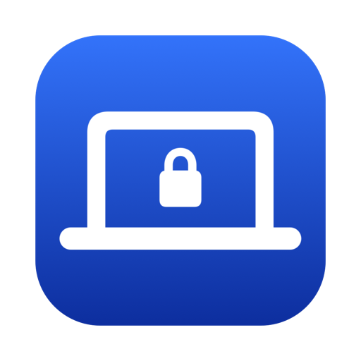

<a id="top"></a>

<div align="center">



<h1>MacGuard</h1>

<p><strong>Smart Protection. Instant Alerts. Better Recovery.</strong></p>

<p>
  
  
  
  
  
  
  
</p>

<p>
  <a href="#features">Features</a> &middot;
  <a href="#build-test-run">Build</a> &middot;
  <a href="#permissions">Permissions</a> &middot;
  <a href="#email-setup-settings--email">Email setup</a> &middot;
  <a href="#limitations">Limitations</a> &middot;
  <a href="#troubleshooting">Troubleshooting</a>
</p>

</div>

A native macOS anti-theft utility. While **armed**, MacGuard watches the charger. If it is unplugged, it sounds a repeating alarm, asks macOS to lock the screen, tries to get the Mac's location, and emails you directly through Brevo. It also guides you through recovery with Apple's built-in **Find My**.

> **MacGuard is a deterrent and recovery aid, not a security boundary.** It cannot stop anyone from shutting the Mac down, force-quitting the app, or removing all power. See [Limitations](#limitations).

## At a glance

| Section | What you will find | Jump to |
|---|---|---|
| Implementation status (honest) | What is implemented, tested on real hardware, or still unverified | [Details](#implementation-status-honest) |
| Features | Monitoring, alarm, authentication, email, follow-ups, offline queue | [Details](#features) |
| Architecture | Diagram of the app, its components and the Brevo connection | [Details](#architecture) |
| Requirements | Supported macOS versions, toolchain, optional Brevo account | [Details](#requirements) |
| Build, test, run | Commands to test, build and smoke-test the app, plus how to install it | [Details](#build-test-run) |
| Permissions | What macOS permissions are used and why | [Details](#permissions) |
| Email setup (Settings → Email) | Brevo account, sender and key, a verified alert address, repeating emails while unplugged, and fixes for common errors | [Details](#email-setup-settings--email) |
| Limitations | What MacGuard cannot do: monitoring, alarm, lock, location, email | [Details](#limitations) |
| Find My recovery | How to use Apple's Find My alongside MacGuard | [Details](#find-my-recovery) |
| Privacy & data | What stays on the Mac and how long it is kept | [Details](#privacy--data) |
| Troubleshooting | Symptom-by-symptom fixes | [Details](#troubleshooting) |
| Release, signing, notarization | Developer ID signing and notarization steps | [Details](#release-signing-notarization) |
| Uninstall | One script that removes the app and its data | [Details](#uninstall) |
| Known issues | Pointer to the known gaps list | [Details](#known-issues) |

<details>
<summary><strong>Table of contents</strong></summary>

- [At a glance](#at-a-glance)
- [Implementation status (honest)](#implementation-status-honest)
- [Features](#features)
- [Architecture](#architecture)
- [Requirements](#requirements)
- [Build, test, run](#build-test-run)
  - [Install](#install)
- [Permissions](#permissions)
- [Email setup (Settings → Email)](#email-setup-settings--email)
- [Limitations](#limitations)
- [Find My recovery](#find-my-recovery)
- [Privacy & data](#privacy--data)
- [Troubleshooting](#troubleshooting)
- [Release, signing, notarization](#release-signing-notarization)
- [Uninstall](#uninstall)
- [Known issues](#known-issues)

</details>

<p align="right"><a href="#top">Back to top</a></p>

## Implementation status (honest)

| Area | Status |
|---|---|
| Power detection (IOKit read + change notifications + reconciliation poll, debounce, dedupe) | Implemented. Reading verified on real hardware; **physical unplug/replug NOT yet hardware-tested** |
| State machine, incidents, event log (SQLite), settings | Implemented, unit-tested |
| Alarm (repeat, volume boost, preview, authenticated stop) | Implemented; playback start verified on hardware, **audibility/muted-speaker cases untested** |
| Screen lock (private `SACLockScreenImmediate`, fallback `pmset displaysleepnow`, verified via CGSession) | Implemented; **verified on a real Mac (macOS 27.0.1): session reported locked**. Not tested on other macOS versions |
| Location (Core Location, timeout, cache/last-known, validation) | Implemented, unit-tested with mocks; **real fix & permission flow awaiting hardware validation** |
| Email: direct to Brevo (key in Keychain), verified Gmail via emailed code, HTML+text templates, offline queue + backoff | Implemented, unit-tested; the Brevo endpoints were checked against the live API with a dummy key. Automated tests never send a real email; the owner reports real alerts through their own Brevo account work (not covered by the test suite) |
| Retry/outbox/offline queue, repeat emails, fresh location on reconnect | Implemented, unit-tested |
| Dashboard, Settings, History, 9-step onboarding, Find My guide, menu bar | Implemented; launch smoke-tested, **not visually reviewed or VoiceOver-audited** |
| Login item (`SMAppService`), restore-after-restart, sleep/wake handling | Implemented; **not hardware-tested** |
| `.xcodeproj` | **Not provided** – Xcode isn't installed on the dev machine; the project is a Swift package + `scripts/build_app.sh` (open `Package.swift` in Xcode to get a project) |
| Developer ID signing / notarization | Documented, **not performed** (ad-hoc signed only) |
| Pre-login / shutdown / sleep-time alarm | **Unavailable** (not possible for a user-space app) |

See [TESTING.md](TESTING.md) for exactly what was run.

<p align="right"><a href="#top">Back to top</a></p>

## Features

| Feature | Details |
|---|---|
| Background protection | Armed monitoring that survives closing the dashboard (menu-bar app); optional start at login; optional resume after restart. |
| Charger-state model | connected / disconnected / unknown, charging, fully charged. Unknown states and API errors **never** raise a theft alert — they degrade monitoring and show a warning. |
| Confirmation delay | Configurable (immediate, 1, 3, 5, 10 s). |
| Arming | Explicit confirmation to arm; refuses to arm if power state is unknown or the charger is unplugged. |
| Owner authentication | Alarm stop / disarm require owner authentication (Touch ID or macOS password via the system `LocalAuthentication` prompt; MacGuard never sees the password). |
| Alert email | incident id, device, battery, power before/after, time zone, alarm & lock status, location (labelled FRESH / CACHED / LAST KNOWN, or "LOCATION UNAVAILABLE"), Apple Maps link only for valid coordinates, recovery steps. |
| One email per theft | The theft alert and the location arrive together in a single email (sent as soon as the location attempt finishes, at most the location timeout, default 20 s; the alarm and screen lock never wait for it). The email has a map link to the position. |
| Back online | If the Mac was offline and the internet returns while a theft is in progress, MacGuard takes a fresh position and emails it, so the link shows where the Mac is now. Several updates queued while offline are collapsed into the newest one. |
| Repeat emails while unplugged | Optional. After the charger is unplugged, an email is sent every 1, 2, 5, 10, 15, 30 or 60 minutes (you choose) for as long as it stays unplugged, up to a limit you set. Plugging the charger back in stops and resets the timer; unplugging again starts a new one. Each email carries the best position available, labelled fresh, cached or last known. |
| Offline outbox | Bounded exponential backoff; resumes on connectivity. |

<p align="right"><a href="#top">Back to top</a></p>

## Architecture

```
┌──────────────────────── MacGuard.app (Swift / SwiftUI) ───────────────────────┐
│ UI: Dashboard · Settings · History · Onboarding · Menu bar                     │
│ AppCoordinator ──► GuardStateMachine (pure)                                    │
│   │ PowerMonitor ◄─ IOKit notifications + 15 s reconcile + wake refresh        │
│   │      └ PowerTransitionDetector (pure: baseline, debounce, dedupe)          │
│   └ TheftResponseCoordinator ─┬ AlarmManager (never waits on anything)         │
│                               ├ ScreenLockService                              │
│                               ├ LocationService ─ CoreLocationProvider         │
│                               └ TheftNotificationService ─ outbox (SQLite)     │
│                                      └ BrevoMailer + EmailTemplates            │
│ RecipientVerifier (emailed 6-digit code) · SecurityEventStore (SQLite 0600)    │
│ Keychain (Brevo API key)                                                       │
└───────────────────────────────┬────────────────────────────────────────────────┘
                                │ HTTPS  api.brevo.com
                                ▼
                  Brevo ──► your verified address (Gmail)
```

No server of your own is needed. Details: [ARCHITECTURE.md](ARCHITECTURE.md).

<p align="right"><a href="#top">Back to top</a></p>

## Requirements

| Item | Details |
|---|---|
| Operating system and toolchain | macOS 13+ (minimum), Apple Silicon primary (built `arm64`). Developed on macOS 27.0, Swift 6.4, **Command Line Tools only** (no Xcode needed). |
| Email alerts (optional) | A free [Brevo](https://www.brevo.com) account. The app has no third-party dependencies and needs no server. |

<p align="right"><a href="#top">Back to top</a></p>

## Build, test, run

<details>
<summary>Show build, test and toolchain details (contributors)</summary>

```bash
scripts/test.sh                 # Swift tests
scripts/build_app.sh debug      # → dist/MacGuard.app (ad-hoc signed)
open dist/MacGuard.app
dist/MacGuard.app/Contents/MacOS/MacGuard --self-check --play   # hardware smoke test
```

With full Xcode you can instead `open Package.swift`, choose the **MacGuard** scheme and run (location prompts need the signed `.app` bundle, so prefer `build_app.sh` for permission testing).

> **Toolchain note.** With only Command Line Tools, `@State` and Swift Testing macros have no compiler plugin by default. The UI uses a small `@Local` wrapper instead of `@State`, and `scripts/test.sh` loads the Swift Testing plugin explicitly. Both also work with full Xcode.

</details>

### Install

| Option | Steps |
|---|---|
| Disk image | Download `MacGuard-<version>.dmg` from the [latest release](https://github.com/prasodium/MacGuard/releases/latest), open it and drag **MacGuard** onto **Applications**. |
| Installer | Download `MacGuard-<version>.pkg` and double-click it (right-click → Open the first time). It always installs to `/Applications`. |
| Built from source | Copy `dist/MacGuard.app` to `/Applications`. |

The first launch of an ad-hoc-signed app requires right-click → Open. Then follow the in-app setup.

<p align="right"><a href="#top">Back to top</a></p>

## Permissions

| Permission | Why | Notes |
|---|---|---|
| Location (`NSLocationUsageDescription`, entitlement `…personal-information.location`) | Include position in alerts | Optional; app works without it. Enable in System Settings → Privacy & Security → Location Services |
| Notifications | Local alarm banner | Optional |
| Login Items | Start at login | Toggle in Settings; user-approved in System Settings |
| Screen lock | None | Uses a private macOS call (see [Limitations](#limitations)); falls back to display sleep, which locks only if *Require password* is set to immediately |

No Accessibility, Full Disk Access, or admin rights are requested. No privileged daemon is installed.

<p align="right"><a href="#top">Back to top</a></p>

## Email setup (Settings → Email)

Email is optional; the alarm and screen lock work without it. Setup takes about ten minutes and has three parts: a Brevo account with a verified sender, an API key, and a verified alert address.

**Part 1: Brevo account and sender**

1. Sign up for a free account at [brevo.com](https://www.brevo.com) and confirm the email Brevo sends you.
2. In Brevo, open **Senders, Domains & Dedicated IPs → Senders** and press **Add a sender**. Enter a name and the address alerts should come from (no domain needed).
3. Open the verification email Brevo sends to that address and confirm it. Wait until the sender shows as **Verified**; an unverified sender is rejected with error 400.

**Part 2: API key**

1. In MacGuard open **Settings → Email** (the gear icon) and press **Get a key…**. This opens Brevo's page (**SMTP & API → API Keys**).
2. Press **Generate a new API key**, name it `MacGuard`, and copy it. Brevo shows it only once. It must be an **API** key (starts with `xkeysib-`), not an SMTP password.
3. Back in MacGuard, paste the key into **API key** and type the verified sender into **Sender**, exactly as it appears in Brevo. Press **Save**. The key is checked with Brevo and stored **only in your Mac's Keychain** (needs Touch ID or your password). The Brevo key row changes to "Saved".

**Part 3: Alert address and test**

1. In **Gmail for alerts** enter the address that should receive alerts (any address works) and press **Send code**.
2. Type the 6-digit code from the email and press **Verify**. The code expires after 15 minutes, allows 5 attempts, and you can request 3 per hour. Alerts go to an address only after it is verified.
3. Press **Send test email** and check the inbox and the spam folder. "Accepted by Brevo" means Brevo took the message; inbox delivery is not confirmed.

**Repeat emails while unplugged (optional)**

In **Settings → Email → Repeat emails while unplugged** set **Send** to *Repeat while the charger is unplugged*, then pick **Every** 1, 2, 5, 10, 15, 30 or 60 minutes and **Stop after** (1 to 24 hours).

| Rule | Behavior |
|---|---|
| Unplug | The first alert is sent at once and the timer starts. |
| While unplugged | An email goes out every interval (10 minutes means at 10, 20, 30 minutes and so on after the unplug). |
| Plug the charger back in | The repeats stop and the timer resets. Unplugging again starts a new incident with a new timer. |
| Each repeat | Includes the best available position and says whether it is fresh, cached or last known. |
| Stop after | Repeats end after the time you set even if the charger is still unplugged. |

**If something fails**

| Message in MacGuard | Cause | Fix |
|---|---|---|
| Brevo rejected the key | Wrong, truncated or revoked key | Generate a new API key and save it again. |
| Brevo rejected the email. Check that the sender address is verified | Sender not verified, or typed differently | Finish Part 1 and copy the address exactly. |
| Your Brevo plan cannot send more email right now | Daily limit reached or account not yet activated | Check Brevo's dashboard for a limit or activation notice. |
| Brevo rate limit reached | Too many requests | Wait and try again. |
| No Brevo key is saved yet | Save did not complete | Repeat Part 2. |
| **Send code** is greyed out | No key saved, or the address has no `@` | Save the key first. |

Brevo may hold new accounts for a manual check before they can send, and it may refuse free-mail senders such as `@gmail.com` unless the domain is authenticated. If sending fails after all steps pass, use a sender address on a domain you control.

The trade-off of having the key on the Mac is explained in [SECURITY.md](SECURITY.md): if the Mac is stolen and not recovered, delete the key in Brevo.

<p align="right"><a href="#top">Back to top</a></p>

## Limitations

| Area | Limitation |
|---|---|
| Charger monitoring | Only detects changes while MacGuard runs. Process death, shutdown, or full power loss go unnoticed; a gap is logged on next start but never converted into a theft event. A Mac unplugged *while asleep* is treated as a real disconnection on wake. |
| Alarm | Can be inaudible (muted/headphones/volume), cannot run during sleep/shutdown/force-quit. Always stoppable by the owner; by default it also stops when the charger is reconnected (Settings → Alarm), while protection stays armed until you disarm. |
| Screen lock | Protects a running session only. macOS has no public "lock now" API, so MacGuard calls the private `SACLockScreenImmediate` (resolved at runtime; unsuitable for the App Store, may change in future macOS) and falls back to display sleep. Reported as *verified* only if macOS reports the session locked. |
| Location | Estimate from Wi-Fi/Core Location, needs permission and network; may be stale. Never IP-geolocated, never fabricated. Not continuous tracking. |
| Email | "accepted" means the provider accepted the request; inbox delivery is not confirmed. A Mac that never reconnects can't send. |
| Pre-login | MacGuard starts after you log in; it can't monitor before login. |
| Battery-only arming | Intentionally not supported: you must arm while on the charger. |

<p align="right"><a href="#top">Back to top</a></p>

## Find My recovery

Enable Find My Mac (+ Find My network), confirm the right Apple Account, check icloud.com/find, use Lost Mode, contact authorities if theft is suspected. MacGuard cannot read Find My locations and never asks for Apple credentials. **OPEN FIND MY** is in the dashboard.

<p align="right"><a href="#top">Back to top</a></p>

## Privacy & data

Everything stays on the Mac except the alert emails sent through your Brevo account. See [PRIVACY.md](PRIVACY.md). Event log retention default 90 days, location history 7 days (both configurable); "Clear" buttons in Settings.

<p align="right"><a href="#top">Back to top</a></p>

## Troubleshooting

| Symptom | What to do |
|---|---|
| *"Cannot arm"* | Charger unplugged or power unreadable; plug in and check Dashboard → Monitoring. |
| *Location unavailable* | Open Settings → Location. If it says *Not asked yet*, press **Allow**. If it says *Denied*, press **Open Location Settings**, turn MacGuard on (or off and on again), then run **Test Location**. After updating from 0.2.0 or earlier you must allow it once more; from 0.2.1 on the permission survives updates because the app now has a fixed signing identity. Unsigned dev runs (bare binary) can't get a prompt; use the `.app`. |
| *Email not arriving* | The Test result is shown in Settings → Email / Tests. 401 = bad key; 400 = the sender is not verified in Brevo; also check spam and Brevo's logs. |
| *Screen lock "unverified"* | The private call was unavailable and the fallback only slept the display; set Lock Screen → Require password → Immediately. |
| *Login item not starting* | Approve it in System Settings → General → Login Items. |

<p align="right"><a href="#top">Back to top</a></p>

## Release, signing, notarization

<details>
<summary>Show release and notarization steps (contributors)</summary>

`SIGN_IDENTITY="Developer ID Application: …" scripts/package.sh` signs with hardened runtime and builds the `.dmg`, `.pkg` and `.zip` in `dist/` (plus `SHA256SUMS.txt`; set `INSTALLER_IDENTITY="Developer ID Installer: …"` to sign the `.pkg`); then `xcrun notarytool submit … --wait` and `xcrun stapler staple` (for the `.dmg`). 

**Fixed local identity (no Apple account needed).** Ad-hoc signing (`-`) gives every build a new identity, so macOS forgets the Location permission after each update. 0.2.1 and later are signed with a self-signed certificate that stays the same: create it once (a code-signing certificate in a dedicated keychain), then run `SIGN_IDENTITY="<certificate name>" SIGN_KEYCHAIN=<path to that keychain> scripts/package.sh` (add `SIGN_KEYCHAIN_PASSWORD` if the keychain has one). Keep the certificate's private key out of the repository. This is not notarized, so the first launch still needs right-click Open. For Developer ID notarization: not performed for this repository's current state; test location, login item and sleep/wake with the signed build (they can behave differently from debug/ad-hoc).

</details>

<p align="right"><a href="#top">Back to top</a></p>

## Uninstall

| Step | Details |
|---|---|
| Disarm | Disarm protection first. |
| Run | `scripts/uninstall.sh` |
| What it removes | The app, `~/Library/Application Support/MacGuard`, preferences and the Keychain item; delete the key in Brevo too. |

<p align="right"><a href="#top">Back to top</a></p>

## Known issues

See [TESTING.md](TESTING.md#known-gaps).

<p align="right"><a href="#top">Back to top</a></p>
